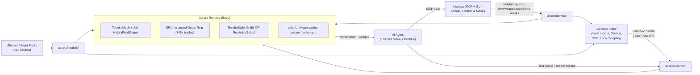

# End-to-End Environment Pipeline: Nerthus -> Jackdaw -> Aurora (Bevy + Jolt + Lobo)

This document describes the complete workflow connecting **Nerthus** (terrain), **Jackdaw** (visual level editor), **Blender / Asset Packs** (3D models), and **Aurora** (Bevy + Jolt Physics + Lobo UI + Dual-Style Rendering) so both **Human** and **AI** can work together smoothly.

---

## High-Level Flow



---

## Stage-by-Stage Workflow

### Stage 1: Terrain & Biome Masks (**Nerthus**)
1. **Create macro + meso shape:** Build the valley/hills/ridges and smooth playable clearings (`< 22°` slope) in Nerthus (visually or via AI using Nerthus's MCP server).
2. **Simulate geology & erosion:** Run hydraulic erosion, thermal erosion, terraces, or outcrops so cliffs and gullies look natural.
3. **Export 5 textures** into `assets/terrain/<zone>/`:
   - `heightmap.exr` (or 16-bit PNG)
   - `mask_slope.png`
   - `mask_flow.png`
   - `mask_wear.png`
   - `mask_deposit.png`

---

### Stage 2: 3D Models (**Blender / Asset Packs**)
Prepare `.glb` assets in `assets/models/` following consistent conventions:
- **Scale:** `1 unit = 1 meter` (`+Y` up, `-Z` forward).
- **Origin & Grounding:** Place pivot at the object's ground contact point, and extend tree trunks, lamp posts, fences, and building foundations `0.2–0.4 m` below `y = 0` so slopes never expose floating bases.
- **Trees (for Ghibli mode):** Prefer alpha-cutout leaf spray cards with baked sphere/fluffy normals over solid smooth blobs.
- **Props (for Realistic mode):** Include proper roughness + normal maps (avoid flat scalar roughness).

---

### Stage 3: Visual Level Layout (**Jackdaw**)
Use **Jackdaw** as your visual 3D GUI editor:
1. Load the zone's terrain heightmap and reference textures.
2. **Block out landmarks & paths first:** Place buildings, bridges, shrines, and road/path markers using transform gizmos and CSG blocks.
3. **Place hero clusters:** Group rocks, trees, bushes, and props into natural **Big -> Medium -> Small** clusters (sink boulders 25–40% into terrain).
4. **Local terrain tweaks:** Use Jackdaw's terrain sculpting/painting if a building pad or road shoulder needs quick hand-adjustment.
5. **Save plain-text scene** to `assets/scenes/<zone>.bsn` (or `.scn.ron`) so both git and AI can read/edit it cleanly.

---

### Stage 4: Runtime Assembly (**Aurora / Bevy + Jolt + Lobo**)
When Aurora loads a zone:
1. **Terrain + Physics Sync:**
   - Loads `heightmap.exr` -> generates chunked terrain mesh AND builds **Jolt's `HeightFieldShape`** from the exact same height array (100% matched collision).
2. **Scene & Style Preset:**
   - Spawns the Jackdaw scene (`assets/scenes/<zone>`).
   - Applies the zone's **`RenderStyle`**:
     - `Ghibli`: Swaps/wraps materials with unified WGSL cel + `tStrokes` brushwork, enables `DepthPrepass` + HDR Alpha-ID Ink + Selective Kuwahara + `0.62` painter's tone curve (`Tonemapping::None`).
     - `Realistic`: Uses PBR `StandardMaterial` + `texture_2d_array` terrain splatting + `Atmosphere` + `AgX` tonemapping + optional `SolariPlugins` ray tracing.
3. **GPU-Instanced Foliage:**
   - Spawns the 1-draw-call torus-wrapped grass ring (`80k–145k` blades) sampling `heightmap.exr` and Nerthus's masks + road exclusion mask directly on the GPU.
4. **Lobo UI Overlay:**
   - Handles pointer/keyboard input *first* in `PreUpdate` (consuming UI clicks before gameplay).
   - Renders dirty UI frames via `renderer-gpu` (`wgpu` batched draw into cached UI texture — or single-threaded `vello_cpu` fallback) and composites it into the final pass (**0 extra draw calls** when UI is idle).

---

### Stage 5: Visual Polish & AI Feedback Loop
1. Run Aurora and capture a screenshot from the real gameplay camera.
2. Hand the screenshot to the AI agent to run the **12-Point Visual Self-Critique Checklist** in [ai_world_generation_guide.md](ai_world_generation_guide.md#4-12-point-ai-visual-self-critique-checklist).
3. AI applies targeted fixes across the right layer:
   - **Terrain shape/erosion issue** -> edits Nerthus graph (MCP) and re-exports.
   - **Prop spacing / grounding / floating issue** -> edits Jackdaw plain-text scene or scatter rules.
   - **Lighting / shadows / grass / fog / shader issue** -> edits `RenderStyle` config or WGSL shaders.
4. Reload and repeat until all 12 items pass.

---

## Recommended Project Folder Layout

```text
assets/
├── terrain/
│   └── sunlit_valley/
│       ├── valley.terrain          # Nerthus project file
│       ├── heightmap.exr           # 16-bit/32-bit heightfield (Bevy + Jolt)
│       ├── mask_slope.png
│       ├── mask_flow.png
│       ├── mask_wear.png
│       └── mask_deposit.png
├── scenes/
│   └── sunlit_valley.bsn           # Jackdaw plain-text scene
├── models/
│   ├── trees/
│   ├── rocks/
│   ├── props/
│   └── characters/
├── textures/
│   ├── strokes/                    # tStrokes painterly brushwork
│   └── terrain_pbr/                # Realistic albedo/normal/roughness arrays
└── shaders/
    ├── painterly/                  # Shared Ghibli cel, grass, ink + Kuwahara
    └── realistic/                  # PBR terrain splat + custom FX
```

---

## Division of Labor: Human vs. AI

| Task | Best Owner | Tool |
| :--- | :--- | :--- |
| Macro terrain, erosion, biome masks | **AI + Human** | Nerthus (MCP + GUI) |
| Visual framing, landmark layout, manual nudging | **Human** | Jackdaw Editor |
| Procedural scatter rules, grounding fixes, lighting & fog tuning | **AI** | Plain-text scenes / `world.ron` |
| Custom WGSL shaders (Ghibli cel, GPU grass, Ink/Kuwahara, PBR splat) | **AI** | Bevy WGSL shaders |
| Hero 3D models & animations | **Asset Packs / Blender** | `.glb` in `assets/models/` |
| Visual quality review & polish passes | **Human + AI** | Screenshot + 12-Point Checklist |
